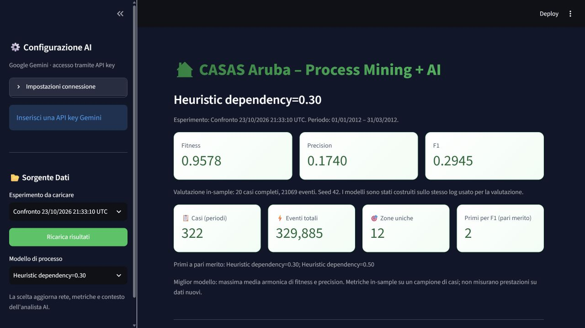
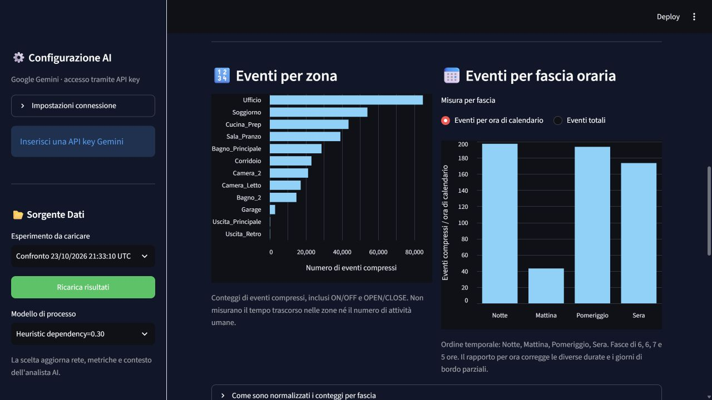
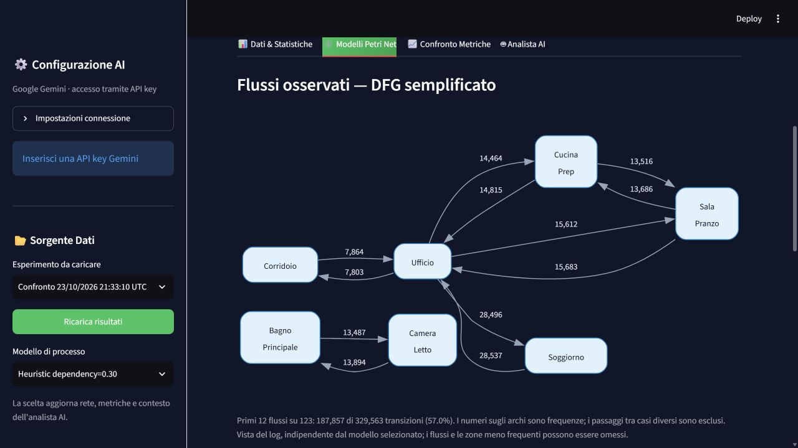
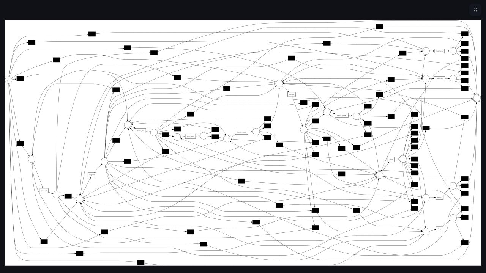
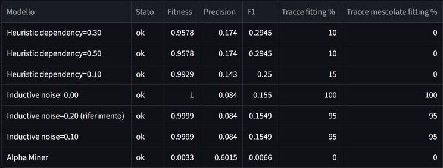
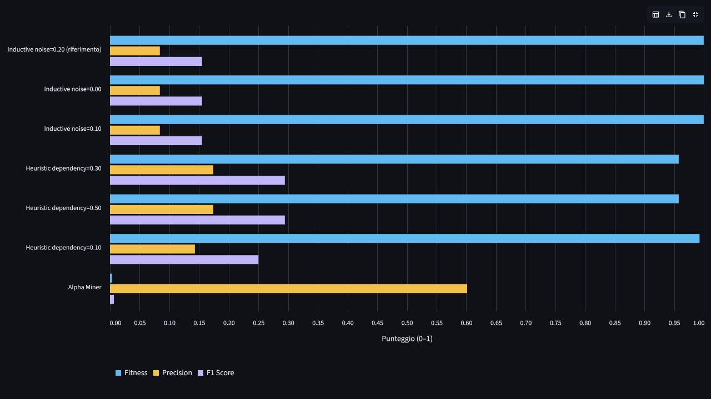

# Process Mining and LLM Support for the Aruba Smart Home Dataset

**Project report | Updated 27 October 2026 | English edition**

This report documents the complete experimental process, from an initial four-week dataset to a seven-configuration comparison over a three-month window and the integration of those results into an interactive dashboard. All seven final runs completed in Google Colab, and their exported artefacts were checked on 27 October 2026. Heuristic Miner with a dependency threshold of 0.30 or 0.50 improves the harmonic mean of fitness and precision by approximately 90% relative to the Inductive reference on the same evaluation sample. Nevertheless, precision remains low, and the order-sensitivity checks do not establish a reliable representation of domestic routines.

The report retains unsuccessful experiments, runs interrupted by resource limits, and the reasons for each methodological change. It also explains the website, documents the checks performed, and distinguishes completed work from further scientific validation. The user guide contains actual screenshots rather than empty insertion markers. Interface labels remain in Italian; their meaning is explained in English without altering the recorded application.

## 1. Project objectives

The project investigates how domestic sensor recordings can be transformed into a comprehensible representation of observed event sequences. Its pipeline prepares an event log, applies process discovery algorithms, evaluates the resulting Petri nets, and presents data and results through a dashboard. An LLM assistant supports the inspection and explanation of the information provided to it.

The central experimental question is: **how well can a model reproduce observed sequences while restricting additional behaviour that is not supported by the log?** A functioning application or fitness close to one is insufficient by itself. The discovered structure must describe something specific about the data.

The dashboard is the project's website application and has been verified locally using Streamlit. The changes documented here concern the local project; they do not establish that it has been deployed to an external hosting service.

The present work is exploratory. Predictive performance, detection of genuine anomalies, and generalisation to other households have not been demonstrated.

## 2. Components and responsibilities

| Component | Role in the project |
|---|---|
| Python preprocessing | Converts sensor records into events, zone labels, and cases. |
| Alpha Miner | Discovers a Petri net using the classical configuration adopted in the project. |
| Heuristic Miner | Discovers a net from event relationships using a dependency threshold. |
| Inductive Miner | Discovers a net through a process structure, with a configurable noise threshold. |
| PM4Py | Provides discovery, export, and conformance evaluation functions. |
| Google Colab | Executes computations that exceed the practical memory capacity of the local PC. |
| Streamlit | Displays datasets, process models, comparisons, and the analyst interface. |
| Google Gemini using an API key | Provides textual assistance based on the context supplied by the dashboard. |

The term “training” was used during operational discussions. More precisely, this project applies **process discovery** algorithms to an event log. Gemini is not trained on this dataset and does not construct the Petri nets evaluated with fitness and precision.

## 3. Dataset and event preparation

### 3.1 Two observation windows

| Property | First experiment | Second experiment |
|---|---:|---:|
| Derived-log period | 1–28 November 2011 | 1 January–31 March 2012 |
| Events after preprocessing | 65,783 | 329,885 |
| Cases | 109 | 322 |
| Zone labels | 12 | 12 |
| Complete sequence variants | 108 | 320 |
| Median events per case | 481 | 884 |
| Maximum events per case | 3,708 | 4,759 |

The second window contains records on 82 of its 91 calendar days. No events are recorded from 20 to 28 March inclusive; this gap is also present in the local raw file. The boundary days of the observation windows are incomplete. Consequently, a three-month calendar interval is not equivalent to three complete months of continuous observation.

The local raw file retains a filename referring to November 2011, although its replacement content covers January–March 2012. The dataset description therefore relies on actual timestamps rather than the filename.

The provenance of this specific extract and the correspondence between the sensor mapping and the correct floor plan still require definitive documentation. Zone labels are assigned by the project's mapping table. Until that mapping is validated, those labels must not be treated as evidence that particular human activities actually occurred.

### 3.2 Preprocessing procedure

1. Read the date, time, identifier, and state of each sensor from the TXT file.
2. Retain the motion and door sensors included in the project mapping; exclude temperature and unmapped sensors.
3. Parse timestamps and associate each retained sensor with its assigned zone.
4. Construct one case for each date and time period: night 00:00–06:00, morning 06:00–12:00, afternoon 12:00–19:00, and evening 19:00–24:00.
5. Compress consecutive repetitions of the same zone within the same case.
6. Export the PM4Py columns `case:concept:name`, `concept:name`, and `time:timestamp` to a derived CSV file.

Both ON and OFF states, and both OPEN and CLOSE states, are retained. A derived event is therefore a compressed sensor record associated with a zone, not necessarily a new activation or a physical movement. Event counts do not measure time spent in a room.

The Colab notebook reads the raw TXT line by line. This bounds memory use during preparation, although discovery still loads the derived log into RAM. A preprocessing report records exclusions, the selected temporal window, and event counts. The streaming reader requires chronological input and reports invalid ordering rather than silently treating it as chronological.

### 3.3 A sensitivity check that was not adopted as the reference pipeline

The initial dataset was also examined under an ON/OPEN-only filter. With the same mapping and compression rule, the derived event count fell from 65,783 to 33,310. This demonstrates substantial sensitivity to the interpretation of sensor states. It does not establish that every removed record is erroneous and is not a complete comparison of models discovered under both preprocessing alternatives.

The current benchmark retains the reference preprocessing to isolate changes in algorithm and threshold. A full evaluation of alternative state filters remains future work.

## 4. Model evaluation

**Token-based fitness** measures the extent to which a model reproduces the observed events. It is not the percentage of traces that can be replayed perfectly.

**Token-based precision** assesses how much the model restricts behaviour beyond what is observed in the log. A precision value of 0.08 does not mean “8% of predictions are correct”: this is not classifier accuracy.

The dashboard labels the harmonic mean of these two metrics **F1**:

`F1 = 2 × fitness × precision / (fitness + precision)`

This is a candidate-ranking criterion, not an absolute quality certification or a classification F1 score. High precision accompanied by near-zero fitness does not indicate a useful representation of the log.

Discovery uses the entire log of each experiment. Evaluation uses complete cases sampled from that same log with seed 42: 50 cases in the first experiment and 20 in the second. These are **in-sample** measurements because evaluation data were available during model construction. No chronological training, validation, and test split has yet been executed.

The third experiment retains the same 20 evaluation cases as the second. A fixed seed makes selection reproducible; it does not create an independent validation set. The 21,069 evaluated events belong to 20 periods, rather than constituting 21,069 independent observations. Many events within a case are related.

## 5. First experiment with four weeks and three algorithms

The first experiment applied Alpha Miner, Heuristic Miner with dependency threshold 0.50, and Inductive Miner with noise threshold 0.20 to the November dataset. It established an operational pipeline and compared three discovery approaches.

| Model | Fitness | Precision | Harmonic mean |
|---|---:|---:|---:|
| Alpha Miner | 0.0229 | 0.6637 | 0.0444 |
| Heuristic Miner | 0.0035 | 0.5355 | 0.0069 |
| Inductive Miner | 0.9978 | 0.1549 | 0.2681 |

Alpha and Heuristic reproduced the log poorly. Their relatively higher precision had to be interpreted together with their extremely low fitness. Inductive ranked first by harmonic mean, but its precision remained weak: the model admitted too much additional behaviour.

For Inductive, only 5 of the 50 evaluated traces were perfectly fitting despite aggregate fitness close to one. The net represented 10 of the 12 labels and omitted the two exit labels. Moreover, 108 variants among 109 cases indicated long, almost entirely distinct sequences. These findings motivated closer inspection of the data representation and the model's selectivity.

## 6. Second experiment with more data and Colab execution

The operational hypothesis was that a longer window might provide a broader range of observations and more examples of infrequent behaviour. Limited memory on the PC was a practical constraint. A self-contained Colab notebook was therefore prepared with preprocessing, discovery, export, and evaluation.

The second completed experiment used approximately three months of data and Inductive Miner alone, retaining a noise threshold of 0.20. Evaluation was limited to 20 complete cases to control its computational cost. The model was exported before evaluation so that it could be recovered if the subsequent computation failed.

| Inductive measure | First experiment | Second experiment |
|---|---:|---:|
| Fitness | 0.997812 | 0.999858 |
| Precision | 0.154879 | 0.083982 |
| Harmonic mean | 0.268138 | 0.154949 |
| Perfectly fitting traces | 5/50 or 10% | 19/20 or 95% |
| Represented labels | 10/12 | 12/12 |

Label coverage improved and the model reproduced the evaluation sample almost perfectly. However, precision declined by approximately 45.8% and the harmonic mean by 42.2%. This did not constitute an overall improvement in process representation.

This historical comparison changes both the observation period and the evaluation sample. It cannot attribute the difference solely to dataset size. It does show that increasing the temporal window while retaining this representation did not resolve the observed problem.

### 6.1 Negative control with shuffled sequences

To investigate sensitivity to event order, zone labels were permuted within each of the same 20 cases while preserving timestamps and label frequencies. Token replay was then repeated.

| Sequences in the second experiment | Fitness | Fitting traces |
|---|---:|---:|
| Observed | 0.9998583842 | 95% |
| Shuffled within cases | 0.9998583842 | 95% |

The model achieved identical values after the order was altered. This suggests weak selectivity with respect to order and explains why high fitness alone is insufficient. It is not a complete anomaly-detection validation: no labelled genuine anomalies were supplied.

A smaller check on the first ten cases of the initial dataset had also produced almost unchanged fitness: 0.997618 on original sequences against 0.997174 on shuffled sequences. These are separate diagnostic checks on different samples, not a common test set.

### 6.2 Observed evaluation cost

The supplied Colab output reports approximately two seconds for replaying the 20 cases and **39 minutes and 30 seconds** for the precision-related pass, whose progress bar contained 20,962 items. Those items concern sequence prefixes used during evaluation, not 20,962 independent periods. Precision was the dominant cost of the old notebook's cell 8.

The exported fitness was `0.9998583842422839` and precision was `0.08398199566503706`. The output confirmed evaluation completion and the ZIP backup on Drive. This duration describes that specific run and is not an estimate for every algorithm.

## 7. Third experiment comparing algorithms and thresholds

**Status: all seven configurations completed; archive received and verified on 27 October 2026.**

The comparison starts from the TXT file and performs preprocessing once. Every candidate receives the same derived CSV and the same 20 complete evaluation cases selected with seed 42. Within this experiment, algorithm or parameter changes are assessed under a common dataset and evaluation protocol.

| Candidate ID | Algorithm | Parameter | Purpose |
|---|---|---|---|
| `inductive_020` | Inductive | Noise 0.20 | Repeat the reference configuration. |
| `inductive_000` | Inductive | Noise 0.00 | Examine the effect of a zero threshold. |
| `inductive_010` | Inductive | Noise 0.10 | Examine an intermediate threshold. |
| `heuristic_030` | Heuristic | Dependency 0.30 | Compare a different discovery algorithm. |
| `heuristic_050` | Heuristic | Dependency 0.50 | Revisit the initial pipeline's threshold. |
| `heuristic_010` | Heuristic | Dependency 0.10 | Examine a lower threshold. |
| `alpha` | Classical Alpha | No threshold varied | Include the third algorithm again. |

The experiment contains seven configurations from three algorithms. Alpha is run once because the classical configuration used here does not expose the two thresholds varied for the other algorithms. Repeating an unchanged configuration on the same data would not add a parameter comparison.

The protocol records fitness, precision, harmonic mean, percentage of fitting traces, omitted labels, net dimensions, and fitness after within-case permutation. The original-minus-shuffled fitness difference is an order diagnostic; no universal threshold makes it a certification of model quality.

### 7.1 Resource limits and operational revisions

Candidates run sequentially in separate processes. The initial notebook settings allowed 600 seconds and 4 GiB per process. During operational discussions, the RAM limit was raised to 10 GiB and a time limit of 2,100 seconds, or 35 minutes, was considered. The previously measured precision computation alone had taken 39 minutes and 30 seconds, so 35 minutes would have been insufficient for a comparable evaluation.

Longer limits were discussed, first 3,600 and then 5,400 seconds per configuration. In the first comparison launched with 5,400 seconds and 10 GiB, the supplied output records `memory_limit` for Inductive 0.20 and 0.00, followed by the start of Inductive 0.10. That earlier run's archive was not supplied, so its exact failure stage and memory demand cannot be established.

The subsequent run, `comparison_20261023T213310299553Z`, retained the 5,400-second timeout and disabled the supervisor's RAM cap with `MAX_MODEL_RAM_GB=None`. Its launch screenshot confirms these settings, and its archive confirms successful completion of all candidates. The artificial cap had been an operational obstacle in the earlier attempts; it was not a model-quality measurement. Colab's physical memory nevertheless remained finite.

In the implementation used for this run, disabling the RAM cap also disabled memory sampling. The exported `peak_worker_gb=0.0` therefore means **peak RAM was not measured**, not zero memory use. These files cannot establish the minimum RAM required to complete the experiment.

The limits cover each candidate process from reading its input through discovery and evaluation. A timeout, memory-limit interruption, or execution error indicates an incomplete attempt. Such attempts must not receive artificial zero scores or be ranked as scientifically inferior results.

Each model is saved before evaluation, and Drive checkpoints are updated after each attempt. These checkpoints preserve completed work; they do not automatically resume an interrupted calculation.

The time limit applies to each configuration, not to the entire cell. Seven 90-minute allowances could permit up to 10.5 hours of candidate processing, although the observed duration was much shorter. Editing limits after starting the cell does not change arguments already passed to the active comparison. Closing the session before the final packaging cell did not delete the checkpoints: the results were recovered by downloading the comparison folder from Drive.

### 7.2 Results of the completed comparison

Durations below are supervisor measurements for each process, including process startup. Metrics were read from the original JSON files and checked against the CSV and metadata; the expensive conformance calculations were not repeated on the PC.

| Configuration | Status | Fitness | Precision | Harmonic mean | Shuffled fitness | Duration |
|---|---|---:|---:|---:|---:|---:|
| Heuristic 0.30 | Completed | 0.957796 | 0.174000 | 0.294500 | 0.960813 | 2 min 50 s |
| Heuristic 0.50 | Completed | 0.957796 | 0.174000 | 0.294500 | 0.960813 | 2 min 48 s |
| Heuristic 0.10 | Completed | 0.992856 | 0.143015 | 0.250017 | 0.978780 | 6 min 49 s |
| Inductive 0.00 | Completed | 1.000000 | 0.083982 | 0.154951 | 1.000000 | 31 min 06 s |
| Inductive 0.20 | Completed | 0.999858 | 0.083982 | 0.154949 | 0.999858 | 25 min 48 s |
| Inductive 0.10 | Completed | 0.999858 | 0.083982 | 0.154949 | 0.999858 | 26 min 13 s |
| Classical Alpha | Completed | 0.003295 | 0.601504 | 0.006555 | 0.003531 | 0 min 50 s |

Heuristic 0.30 and 0.50 share first place: fitness 0.957796, precision 0.174000, and harmonic mean 0.294500. Relative to Inductive 0.20, their harmonic mean improves by 90.06%, although its absolute value remains approximately 0.29. The manifest lists 0.30 first because that candidate occurs earlier in the configuration order; this is not evidence that it outperforms 0.50.

PNML checks confirm that Heuristic 0.30 and 0.50 produce isomorphic marked, labelled graphs: the structure is equivalent up to internal node identifiers. The same holds for Inductive 0.20 and 0.10. Changing a threshold within those pairs did not create a structurally different alternative.

Inductive 0.00 increases net complexity to 52 places and 65 transitions, compared with 36 and 41 for the reference. Precision is identical, while the harmonic mean rises by only about 0.000002. This change does not address permissiveness. Alpha remains unsuitable for this log under the tested configuration, with fitness 0.003295 and no perfectly fitting cases.

All new PNML files represent the 12 log labels. The `NaN` entries shown under omitted labels and errors in the original screenshot arose from empty CSV fields. The JSON files contain empty omitted-label lists and `ok` statuses; those entries are not hidden discovery failures.

### 7.3 Order sensitivity and complete traces

For Heuristic 0.30 and 0.50, aggregate shuffled fitness is slightly higher than original fitness: 0.960813 against 0.957796, a difference of −0.003017. The detailed JSON files add an important qualification: perfectly fitting traces fall from 2/20 on original sequences to 0/20 after shuffling. There is a signal in this stricter measure, but it involves only two cases and does not establish strong general order discrimination.

Heuristic 0.10 has original fitness 0.992856 and shuffled fitness 0.978780, giving a positive difference of 0.014076. Fitting traces fall from 3/20 to 0/20. This is the most favourable aggregate order-sensitivity signal among the tested configurations. Its precision, however, declines to 0.143015 and its harmonic mean to 0.250017. The preferred candidate therefore also depends on the intended objective, rather than ranking alone.

Inductive 0.00 retains fitness 1 and 20/20 fitting traces after shuffling. The 0.10 and 0.20 settings retain fitness 0.999858 and 19/20 fitting traces on both logs. Alpha has 0/20 fitting traces on both. The control uses one permutation with seed 42; it is not a distribution across repeated permutations and does not replace labelled real anomalies.

### 7.4 Observed durations and artefact integrity

The seven candidate processes took approximately **1 hour and 36 minutes** in total, excluding common preparation and intervening backups. Inductive required about 26–31 minutes per configuration; Heuristic 0.30 and 0.50 about three minutes; Heuristic 0.10 about seven minutes; and Alpha about 50 seconds. These are measurements from this execution, not guarantees for other runtimes.

The Inductive reference completed faster than the 39-minute-and-30-second precision pass observed previously. No single code or resource change is claimed as the cause of that runtime difference.

Local verification passed 73 checks involving fingerprints, the evaluation sample, metrics, formulas, individual result files, and PNML structures. The canonical dataset matches the second experiment: 329,885 events, 322 cases, and 12 zones. The same 20 evaluation cases contain 21,069 events, and the exported evaluation CSV exactly matches the reconstructed complete-case sample with seed 42. Inductive 0.20 reproduces the previous export's fitness and precision exactly.

Recorded versions are PM4Py 2.7.23.11, pandas 2.2.3, and NumPy 2.1.3. These checks establish consistency among exported artefacts, not independent recomputation of conformance metrics. Ranking remains in-sample. Selecting a threshold on these cases and then reporting performance on them as performance on new days would be incorrect.

### 7.5 Net dimensions and label coverage

| Configuration | Places | Total transitions | Silent transitions |
|---|---:|---:|---:|
| Inductive 0.20 | 36 | 41 | 29 |
| Inductive 0.00 | 52 | 65 | 53 |
| Inductive 0.10 | 36 | 41 | 29 |
| Heuristic 0.30 | 26 | 93 | 81 |
| Heuristic 0.50 | 26 | 93 | 81 |
| Heuristic 0.10 | 25 | 98 | 86 |
| Classical Alpha | 9 | 12 | 0 |

Silent transitions are internal net steps without a zone label. Their presence does not in itself indicate an error, but their number contributes to representational and visual complexity. More transitions do not automatically imply a better model, and a smaller net is not automatically more faithful. Representing all 12 labels establishes their presence, not the correctness of their connections or the ability to reproduce every case.

## 8. Dashboard revision and AI context

The audit examined how results were communicated as well as whether the calculations ran. Four presentation problems were corrected.

| Initial issue | Implemented correction | Interpretation |
|---|---|---|
| Fitness, precision, and harmonic mean were stacked. | Separate bars on a fixed 0–1 scale. | Metrics are no longer added as though they were additive components. |
| Counts were described as activations or activities. | Labels explicitly refer to compressed events and zones. | Event frequency is distinguished from presence and duration. |
| Periods lasted 6, 6, 7, and 5 hours. | Calendar-exposure-normalised comparison, with totals also available. | Raw totals are not automatically interpreted as comparable intensities. |
| The full net had very small labels. | A simplified DFG accompanies the complete net. | Predominant flows become easier to inspect while the detailed net is retained. |

Normalisation uses calendar exposure between the first and last timestamps and accounts for partial boundary days. It does not automatically correct internal acquisition gaps, including the nine missing days in the newer dataset, and does not measure room occupancy.

The DFG represents transitions observed in the log, not the selected Petri net, and cannot certify that net's quality. Its simplified view omits less frequent flows. Gemini receives complete sampled cases within a 20,000-row budget, the selected model context, and observed flows. Sampling does not guarantee whole-log representativeness; responses must distinguish observations from interpretation.

Historical audit screenshots describe the application at the time they were captured. On 27 October 2026, the dashboard with the newly installed artefacts was also checked for model selection, metric summaries, tied leaders, and comparison-chart readability.

### 8.1 Experiment and model selection

The received comparison was installed under `data/experiments/comparison_20261023T213310299553Z/`. Dataset and metrics remain associated with the models from that execution, rather than being mixed with another experiment's files.

Two sidebar controls are available. **Esperimento da caricare** selects and automatically loads a results package. **Modello di processo** chooses which of its seven configurations to display: classical Alpha, three Heuristic settings, and three Inductive settings. Loading reads saved artefacts; it does not repeat discovery or expensive evaluation.

The selected model appears in the main summary title, the Petri-net view, and the configuration metrics. The comparison panel continues to show all candidates from the same experiment. Selecting another net does not change the common event log or its DFG.

The initial selection uses the first candidate with the highest harmonic mean. This comparison initially proposes Heuristic 0.30, while explicitly reporting **two tied leaders**, including Heuristic 0.50. The first displayed option is not presented as a demonstrated scientific improvement over the other tied model.

The illustrated Heuristic 0.30 values are fitness 0.9578, precision 0.1740, and harmonic mean 0.2945. Common dataset counts are 322 cases, 329,885 events, and 12 zones. Values displayed on screen are rounded; JSON files retain full precision.

### 8.2 Comparison and diagnostic information

The **Confronto Metriche** tab includes status, fitness, precision, harmonic mean, percentages of fitting original and shuffled traces, shuffled fitness, order difference, duration, omitted labels, and errors. Its table can be downloaded as CSV.

For seven configurations, the chart uses grouped horizontal bars to keep parameterised names readable. Its scale is fixed at 0–1; the three metrics are not summed. Empty omitted-label fields are displayed as “Nessuna” (“None”) rather than a potentially misleading CSV `NaN`.

The complete Petri net remains available in the model tab. The simplified DFG improves readability but does not replace analysis of the nets or reveal every rare behaviour. Perfectly fitting trace counts must also be considered alongside aggregate fitness, particularly for Heuristic, where the measures capture different aspects of replay.

### 8.3 Connecting selection to the AI analyst

The textual context supplied to analyst actions identifies the active experiment and configuration. It includes selected metrics, candidate comparisons, available diagnostics, evaluation information, and a net summary containing places, transitions, arcs, and labels. The DFG is separately identified as the observed log structure.

Changing models clears the conversation and last report so that an earlier response is not implicitly attributed to the new configuration. Changing datasets also clears derived summaries and CSV-context references, which must then be prepared again. AI service settings remain distinct from the selected process-mining algorithm.

This connection makes the supplied context consistent, but does not guarantee correct generated answers. The assistant receives a net summary and observed flows, not the complete executable semantics of the net. Changing the selection neither trains Gemini nor validates it as a next-event predictor. Anomaly and next-zone suggestions remain exploratory and require verification.

### 8.4 Application checks

Five dedicated tests of results management completed successfully. They verify consistent loading of seven models, exclusion of incomplete packages from the catalogue, rejection of a mismatched CSV fingerprint before pickle loading, correspondence between AI context and selection, and model switching within the interface.

The interface test switches from Heuristic 0.30 to Inductive 0.00, verifies fitness 1.0000 and precision 0.0840, and checks removal of previous chat and report content. It also verifies that selecting manual upload does not leave the previous package's results displayed. These checks do not perform discovery or real AI-service requests.

Browser inspection confirmed the seven options, switching behaviour, displayed values, and chart readability. The five application tests are distinct from the 73 Colab-artefact integrity checks. Neither group demonstrates generalisation to new data.

The Gemini revision passed all **30 automated tests** in the suite, including agreement between the installed CSV and raw data, preprocessing, embedded notebook sources, sampling, export, experiment management, charts, and the Gemini client with simulated responses. Client tests send no real requests to Google. Discovery tests use small synthetic logs; full-dataset discovery was not repeated. These technical checks do not establish generalisation to new data.

### 8.5 Installed files and project operation

The comparison package is already installed locally. Run `avvia_dashboard.bat`, choose the experiment, and then select a model in the sidebar. No additional download or Colab rerun is required for consultation. **Ricarica risultati** reloads the selected package; **Upload manuale** accepts another trusted CSV, PKL, and metrics set.

| Project location | Contents and purpose |
|---|---|
| `data/experiments/comparison_20261023T213310299553Z/data/` | Common CSV, model pickle, metrics, and evaluation metadata for the installed comparison. |
| Parent of that data directory | Detailed results, manifest, comparison CSV, and package versions. |
| `audit/colab_received_2026-10-27/` | Extracted original archive, including candidate logs and PNML files. |
| `dashboard_results.py` | Package catalogue, consistency checks, and selected-model summary. |
| `dashboard.py` and `dashboard_charts.py` | Interface, selectors, model views, comparisons, and charts. |
| `tests/test_dashboard_results.py` | Five dedicated checks of experiment loading and model selection. |

The main `data/` directory also retains earlier artefacts, but its derived CSV was missing at inspection time. That incomplete package is not offered by the catalogue. The installed comparison has its own complete CSV. The second experiment's Inductive 0.20 reference is also represented among the seven new candidates. The original four-week experiment remains documented in historical audits and is not artificially reconstructed as a loadable package.

To add a future comparison, extract a new folder under `data/experiments/`, retaining its `data/` subdirectory and comparison JSON files in the parent. Do not overwrite the previous package. Models, CSV, metrics, and metadata must be transferred together: retaining old metadata beside new results would undermine traceability.

## 9. Website user guide with screenshots

This chapter follows a practical demonstration: loading results, exploring events, inspecting flows and nets, comparing metrics, and accessing the AI analyst. Figures S1–S8 occupy the positions proposed in the Italian guide. They are genuine captures of the local application; interface labels remain in Italian and are explained below.

The dataset and process-model selection remain consistent across the figures. Heuristic 0.30 is used as the reference display configuration. Figures S7 and S8 document the actual unconfigured AI state. They do not show a successful provider call or a generated analytical answer; the application greeting is built-in interface text.

### 9.1 Start the application and select results

Run `avvia_dashboard.bat` from the project root and open the local address printed in the terminal. Under **Sorgente Dati** (“Data source”), choose **Esperimento da caricare** (“Experiment to load”). The results package loads automatically. Use **Modello di processo** (“Process model”) to choose one of the available configurations.

The selected configuration appears above fitness, precision, and F1. The page also displays the dataset period, cases, events, zones, and tied leaders. These details identify the experiment being discussed. Viewing data and models does not require a Gemini API key.

For this configuration, the summary displays approximately 0.9578 fitness, 0.1740 precision, and 0.2945 harmonic mean. The two tied leaders remain explicitly identified. Opening the model menu reveals all seven alternatives; changing the selection updates the active net and metrics.

### 9.2 Explore events and distributions

Open **Dati & Statistiche** (“Data and statistics”). The initial table displays a sample of event-log rows, including case, zone, and timestamp. Below it are event distributions by zone and period. To compare periods of different lengths, retain **Eventi per ora di calendario** (“Events per calendar hour”); **Eventi totali** shows raw totals instead.

Expand **Come sono normalizzati i conteggi per fascia** to inspect the denominator table. It shows the calendar hours used at the log boundaries. This correction does not repair internal acquisition gaps or estimate time spent in rooms.

The charts describe compressed sensor events, including retained OFF and CLOSE states. The higher count in a zone does not establish longer occupancy or a greater number of validated human activities. The visible period choice and axis units are part of the evidence needed to interpret the chart.

### 9.3 Inspect observed flows

Open **Modelli Petri Net** (“Petri-net models”). The first visualisation is **Flussi osservati — DFG semplificato**, the simplified directly-follows graph. Nodes represent zones and arcs represent consecutive within-case transitions. Arc labels are frequencies; the accompanying note reports how much of the log's transition structure is displayed.

The DFG depends on the loaded dataset. It remains unchanged when only the process-model configuration changes within the same experiment, because it represents the common observations rather than the selected net.

In this view, the top 12 of 123 distinct flows account for 187,857 of 329,563 within-case transitions. Less frequent flows and some zones are omitted from this simplified representation. The graph must not be interpreted as a reduced version of the selected Petri net.

### 9.4 Inspect the selected Petri net

In the same tab, scroll to **Rete di Petri completa** (“Complete Petri net”). This visualisation corresponds to the sidebar selection. The fullscreen control expands it; **Dettaglio Petri Net** provides the numbers of places, transitions, and arcs.

Switching from Heuristic 0.30 to Inductive 0.00 demonstrates the distinction between common data and selected model: the net and metrics change, while event counts and the DFG remain shared. A full net may be visually dense, so the configuration must be identified and its rendering should not be presented as independent proof of quality.

This figure shows the net's overall complexity, not a legible transcription of every small label. Heuristic 0.30 contains 26 places, 93 transitions, and 188 arcs, including 81 silent transitions. Use the DFG for a readable account of common observed flows and the PNML artefact for detailed net inspection. The screenshot alone does not establish soundness or conformance.

### 9.5 Compare configurations and order diagnostics

Open **Confronto Metriche** (“Metric comparison”). The table initially ranks the seven candidates by harmonic mean. It also contains status, shuffled fitness, original-minus-shuffled fitness, percentages of perfectly fitting traces, duration, omitted labels, and errors. Fullscreen mode and horizontal scrolling expose the diagnostic columns. Clicking a column header changes the displayed ordering.

The demonstration should show both the Heuristic 0.30/0.50 improvement and the weak aggregate order discrimination. Their tie is not two independent improvements: the nets have equivalent marked, labelled structures. **Scarica tabella del confronto** downloads the table as CSV.

The screenshot contains rounded values and the application labels; this view is sorted by harmonic mean, with the tied Heuristic configurations first. Its excerpt focuses on the main scores and perfectly fitting trace percentages for readability. Additional diagnostic columns are available by horizontal scrolling, and the complete numerical comparison is provided in Chapter 7. “Tracce fitting” denotes perfectly fitting original traces, “Tracce mescolate fitting” the corresponding shuffled percentage, and “Differenza ordine” the original-minus-shuffled aggregate fitness difference.

The chart below the table uses separate horizontal bars for fitness, precision, and their harmonic mean on a common 0–1 scale. The sidebar identifies the active configuration, but the chart continues to compare the full experiment.

Inductive's fitness bars approach one while its precision bars remain low. Heuristic improves the balance without reaching strong precision. Alpha's relatively high precision must be considered together with almost zero fitness. The three bars must never be summed.

### 9.6 Configure the AI analyst

In the sidebar, expand **Impostazioni connessione** (“Connection settings”), enter a valid **API Key Gemini** and a model available to the account, then press **Configura Gemini**. Alternatively, supply the key through the `GOOGLE_API_KEY` environment variable. A key entered in the dashboard remains in the session and is not automatically saved to `config.json`.

“Configurato” indicates client initialisation. Connectivity is checked on the first request, so that message alone is not evidence of a completed provider response. The analyst tab contains chat, report generation, possible-anomaly suggestions, and next-zone suggestions. These functions do not alter the saved process nets or metrics.

No credentials are exposed in this figure. The displayed language-model name is a configured interface value, not confirmation of its availability to an authenticated account. The screenshot documents setup requirements, not successful AI execution.

### 9.7 Use the analyst and download a report

Before submitting a question, check the selected process model. Once a service is available, a suitable question is: “Explain the limitations of the selected model using precision, fitness, and the results on shuffled sequences.” The application passes the configured context to Gemini and displays the response.

**Genera Report Completo** (“Generate complete report”) requests a textual report. Following a successful generation, a download control makes that report available as TXT. Responses must be compared with the original metrics and must separate observations from hypotheses. A plausible answer does not replace anomaly validation or a predictive evaluation.

At capture time, Gemini had no configured API key. Therefore, this figure intentionally records the interface before execution rather than a generated answer. The introduction is application text; it is not proof that a language-model request succeeded. No synthetic response has been inserted into the report.

Changing the process configuration clears earlier chat and reports. A later authenticated demonstration can add a real response and successful report download, with the language-model provider, selected process model, and execution context identified. Such a demonstration remains distinct from scientific validation of the mining results.

### 9.8 Figure placement and maintenance

All eight figure positions have been completed in this English edition. Figures appear after the relevant operational explanation and include captions identifying the function and, where applicable, the selected model. Figure S5 preserves the screenshot’s natural aspect ratio, with no Word crop or floating positioning; S4 is explicitly a structural overview because of the complete net's visual complexity.

For future revisions, replace an image in line with the text and retain the caption immediately beneath it. Keep model, dataset, period, and values consistent with the surrounding explanation. Multiple captures of a function may be labelled S2a/S2b or S5a/S5b. Do not silently substitute a different dataset's screenshot. S7 and S8 describe the verified setup state and must only be relabelled as successful execution after a genuine provider response is recorded.

## 10. Summary of the experimental process

| Stage | Question | Intervention | Evidence and status |
|---|---|---|---|
| Initial log | Which algorithm best represents four weeks? | Alpha, Heuristic 0.50, Inductive 0.20. | Completed: Inductive ranked first, with low precision. |
| Representation audit | What do events, cases, and charts mean? | Examined zone mapping, states, distributions, and the AI sample. | Reported checks completed; physical mapping still requires validation. |
| Move to Colab | How can more data be processed within PC limits? | Streaming preprocessing, single-model discovery, exports, and backups. | Completed and used in the second experiment. |
| Larger log | Do more observations improve Inductive? | Three months, noise 0.20, evaluation on 20 cases. | Completed: lower precision and harmonic mean than the historical reference. |
| Order diagnostic | Does high fitness reflect observed order? | Within-case permutation and repeated replay. | Completed: identical aggregate results on the second sample. |
| Controlled comparison | Do algorithm or threshold changes improve the balance? | Seven configurations with a common log and sample. | Completed: Heuristic 0.30/0.50 tied first; selectivity remains weak. |
| Dashboard integration | How can alternatives be inspected without mixing artefacts? | Experiment catalogue, configuration selector, diagnostics, and consistent AI context. | Completed: seven models, five passing tests, and browser inspection. |
| Future validation | Does performance hold on new days? | Chronological separation after development decisions. | Not yet designed and executed as a completed experiment. |

## 11. Conclusions from the experimental process

The project provides an end-to-end pipeline, reproducible exports, and an interface for exploring results. The development process has also produced useful negative evidence: high fitness does not imply selectivity, and a larger dataset did not automatically improve representation.

Four main limitations remain: zone semantics require validation, temporal cases are long and highly variable, evaluation is in-sample, and temporal coverage is incomplete. The controlled comparison addresses algorithm and threshold choice; it does not resolve these other issues by itself.

Changing algorithm produced a concrete metric improvement. Heuristic 0.30 and 0.50 are the reference candidates for the fitness–precision balance in this experiment. Low precision and the negative control prevent them from being presented as validated routine or anomaly models. Heuristic 0.10 remains relevant for further study because it shows a larger aggregate fitness difference after shuffling.

The next priority is to validate the sensor mapping and compare more meaningful event and case definitions, for example by distinguishing sensor states and defining episodes according to the application question. These alternatives have not yet been evaluated as complete pipelines. Before further threshold selection, development, configuration selection, and final testing must be separated chronologically without splitting the same case across sets.

The project's methodological contribution lies in this documented progression: a weak initial comparison, dataset expansion without overall improvement, a diagnosis of permissiveness, a resource-limited attempt, and a subsequent completed comparison with better metrics. Its conclusion follows from that process rather than from selecting a single favourable score.

### 11.1 Overall assessment

As an educational prototype and experimental study, the work has a complete pipeline and an evidence-driven progression. The dashboard makes results and limitations inspectable without hiding unsuccessful alternatives. Recognising that operational success and a high score do not validate a behavioural interpretation strengthens the project report.

As a system ready to recognise routines or anomalies reliably, the evidence remains insufficient. The leading candidate's precision is approximately 0.174, only two of the twenty cases are perfectly fitting, and aggregate fitness does not decline after shuffling. Those findings support an honest scientific discussion, not a claim of reliable detection.

The relative 90% improvement must not be described as “90% accuracy”: the harmonic mean increases from about 0.155 to 0.2945. Nor can the new Heuristic result be declared superior to the November Inductive model on a common test, because periods and samples differ. Controlled conclusions apply to the seven configurations on the January–March log.

### 11.2 Current decision and next steps

For demonstration, Heuristic 0.30 is proposed while explicitly acknowledging the tie with 0.50 and keeping every configuration available. Heuristic 0.10 is an alternative for further investigation of order sensitivity. Harmonic-mean ranking and that application objective are not equivalent; no model has yet been validated as the best choice for every intended use.

The next development cycle should proceed as follows:

1. Verify TXT provenance, floor plan, and sensor mapping, then justify retained states and treatment of missing days.
2. Define a measurable objective and a chronological split before experimenting. Select representation and thresholds using development data, leaving final test data out of those decisions.
3. Compare the reference preprocessing with motivated alternatives under the same protocol. The ON/OPEN check performed so far measures event-count sensitivity, not an evaluated model improvement.
4. Repeat negative controls across several permutations and report variability. Anomaly-detection claims require relevant anomaly examples and an explicit evaluation procedure.
5. Consider extending the temporal window after establishing that the representation is meaningful. Six months was discussed as a possible extension; it was not used in the completed experiments and cannot guarantee an improvement.

These are future activities. No additional discovery was run on the PC to update the documentation or enable the dashboard selector.

## 12. Traceability and outstanding verification

The received archive was `comparison_20261023T213310299553Z-20261027T170514Z-1-001.zip`. Its extracted contents are retained under `audit/colab_received_2026-10-27/`, separately from the dashboard's installed package. Closing the session before the final cell did not prevent recovery of the Drive checkpoints.

The package contains the comparison table, detailed results, manifest, metadata, logs, common CSV, model pickle files, and PNML files. The preprocessing report is not included in the comparison folder; it may be in the parent run folder on Drive. Canonical fingerprint matching verifies the identity of the derived log, not the raw TXT's provenance or every preprocessing exclusion.

Physical sensor mapping and evaluation on new days remain open. The updated dashboard was checked in the browser after the seven candidates were installed. The earlier memory-limited attempt is documented by the supplied output, but its archive is not part of the received package.

Manifest and JSON files are retained with their corresponding results. Byte-level CSV fingerprints are distinguished from canonical fingerprints of the three event columns. Windows/Linux line-ending differences alone do not establish changed events. Display rounding is for readability; ties and improvements are assessed using full-precision values.

The 27 October revision preserves the earlier experiments. Audits dated 22 and 23 October are historical evidence and do not describe the updated interface. The English guide's screenshots show the actual application state, including the unavailable AI provider connection; that limitation is not concealed by a fabricated response.

## 13. Repository evidence

- [Initial dataset audit](audit/VALUTAZIONE_RISULTATI.md) and [historical diagnostics](audit/results_audit.json).
- [Comparison after the move to Colab](audit/CONFRONTO_COLAB_2026-10-23.md) and [second-dataset diagnostics](audit/colab_comparison_2026-10-23.json).
- [First Colab computation notebook](Aruba_Colab_Training.ipynb).
- [Three-algorithm comparison notebook](Aruba_Colab_Confronto_Modelli.ipynb).
- [Colab preprocessing and export](colab_pipeline.py), [benchmark execution](colab_benchmark.py), and [local-pipeline evaluation](evaluation.py).
- [Received-comparison verification](audit/comparison_verification_2026-10-27.json) and [verification script](audit/verify_received_comparison.py).
- [Dashboard experiment management](dashboard_results.py) and [results-selection tests](tests/test_dashboard_results.py).
- [Model-selection screenshot](audit/dashboard_scelta_modelli.png), [comparison screenshot](audit/dashboard_confronto_sette_modelli.png), and the English guide's figures in `audit/en_screenshots/`.

Historical figures are derived from the retained audits and supplied Colab output. Third-experiment results come from the JSON and PNML files received on 27 October 2026. The report distinguishes exported measurements, local integrity checks, application tests, operational screenshots, and scientific validation that remains to be performed.
