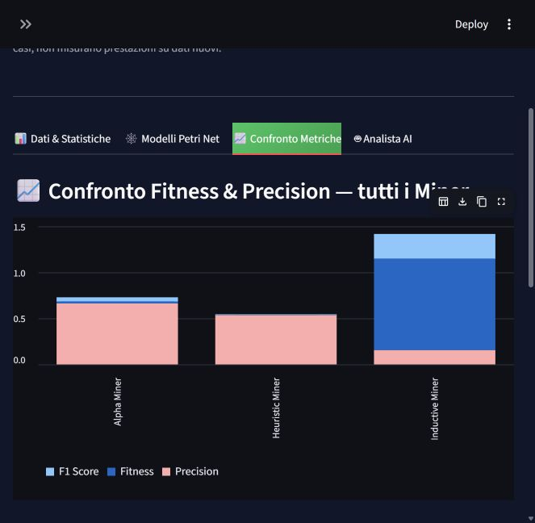
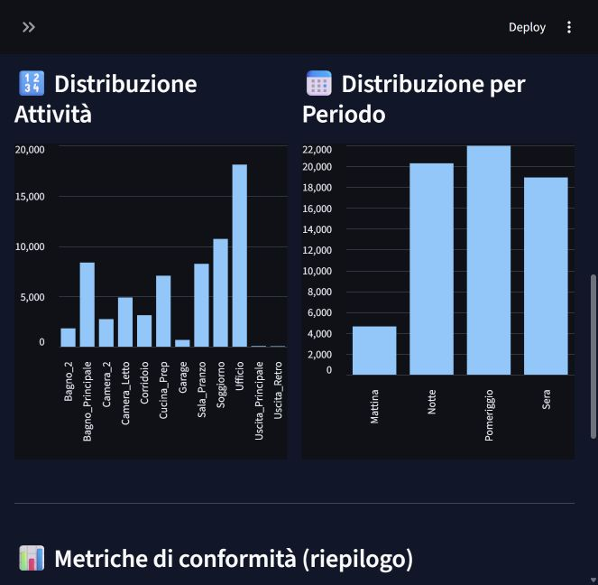
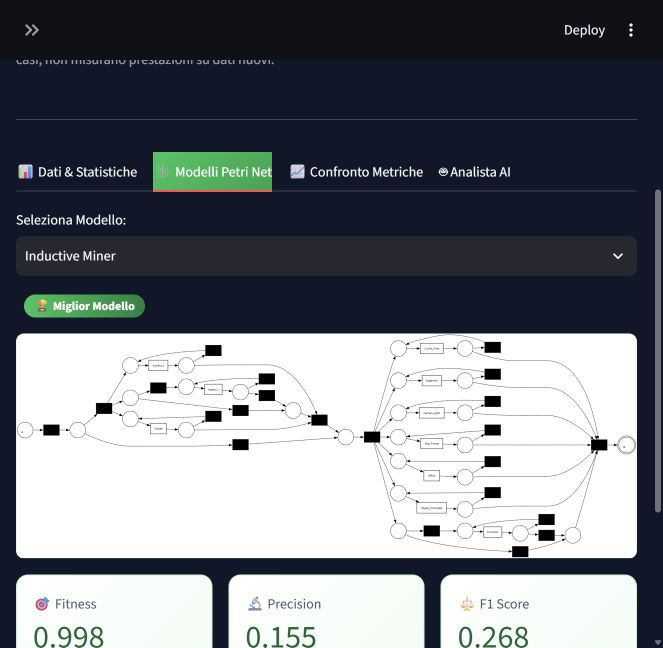

# Valutazione di dataset, risultati e dashboard

Audit del 22 ottobre 2026, precedente alle successive correzioni della presentazione. Le schermate e la diagnostica del campione locale documentano lo stato prima delle modifiche; per la versione corrente consultare il README. I sorgenti applicativi e gli artefatti della pipeline non sono stati modificati durante questo audit. Sono stati aggiunti soltanto questa relazione, uno script diagnostico, i risultati JSON e schermate della dashboard.

## Giudizio complessivo

Il progetto è una buona base come prototipo didattico: pipeline completa, confronto fra tre algoritmi, risultati riproducibili, interfaccia e predisposizione di assistenza LLM. I risultati attuali di discovery sono però deboli nel descrivere una routine specifica. Non dimostrano ancora buone prestazioni di previsione o rilevazione delle anomalie. È difendibile presentarlo come studio esplorativo che mette in evidenza i limiti del process mining su log domestici molto variabili, esplicitando i risultati negativi.

La verifica tecnica precedente dimostrava che la pipeline funzionava e che i file concordavano; questo audit valuta anche cosa significano i numeri e come vengono presentati.

## Dati effettivamente disponibili

- 65.783 eventi derivati, 109 casi, 12 etichette di zona.
- Finestra osservata: 1–28 novembre 2011; primo e ultimo giorno incompleti.
- Lunghezza mediana: 481 eventi per caso; media 603,5; massimo 3.708.
- 108 varianti diverse in 109 casi. Le prime cinque varianti coprono solo 6 casi, cioè il 5,5% del totale.

Il numero di eventi è sufficiente per fare analisi esplorative. I 65.783 eventi non sono altrettante osservazioni indipendenti: appartengono a un singolo log domestico di circa quattro settimane. Le fasce orarie sono finestre costruite dal preprocessing, non episodi di attività etichettati. Con tracce così lunghe e quasi tutte diverse, confrontare la routine completa e interpretare le varianti prevalenti è difficile.

### Provenienza e significato delle etichette

La raccolta CASAS è una fonte riconosciuta, ma bisogna documentare il collegamento fra questo specifico file estratto, la versione del testbed e la relativa pianta dei sensori. La tabella ufficiale presenta Aruba come una raccolta annotata del 2010–2011; il file locale contiene data, ora, sensore, stato e tipo di sensore, senza una colonna di attività umana annotata nelle cinque colonne analizzate. La data o il nome del file da soli non certificano quale variante o esportazione sia stata usata.

Fonti: [catalogo ufficiale CASAS](https://casas.wsu.edu/datasets/), [descrizione originale del challenge BP-Meet-IoT e pianta Aruba](https://bp-meet-iot.webs.upv.es/2022/challenge2022/BP_Meets_Iot2022_Challenge.pdf).

La mappa `SENSOR_ACTIVITY_MAP` è convenzionale e non validata rispetto alla pianta di questo estratto. Le conclusioni su ufficio, bagni, garage o cucina dipendono da questa verifica. Fino ad allora, i nomi sono etichette di gruppi di sensori e non prove di attività svolte.

### Sensibilità a ON/OFF

Il preprocessing considera 92.269 ON, 92.269 OFF, 400 OPEN e 400 CLOSE. Con la stessa mappa e segmentazione, conservando solo ON/OPEN e poi comprimendo i duplicati, gli eventi derivati scendono da 65.783 a 33.310 (-49,4%).

Questo non prova che il 49,4% degli eventi sia errato. Dimostra che i risultati dipendono molto dal significato attribuito agli spegnimenti. Un OFF può arrivare dopo un'attivazione in un'altra zona e generare un apparente ritorno. Prima di interpretare sequenze come spostamenti reali occorre confrontare entrambe le configurazioni e motivare la scelta.

## Qualità dei modelli

| Modello | Fitness token-based | Precision token-based | Media armonica |
|---|---:|---:|---:|
| Alpha Miner | 0,0229 | 0,6637 | 0,0444 |
| Heuristic Miner | 0,0035 | 0,5355 | 0,0069 |
| Inductive Miner | 0,9978 | 0,1549 | 0,2681 |

Le metriche derivano da 50 casi del log usato anche per la discovery. La valutazione è in-sample: non dimostra generalizzazione a nuovi giorni o nuove abitazioni.

Alpha e Heuristic riproducono male il log. La precision, considerata senza la bassissima fitness, non basta per considerarli buoni modelli. Anche la struttura è problematica: Alpha contiene due nodi non raggiungibili strutturalmente dal marking iniziale e cinque senza percorso verso quello finale; per Heuristic i conteggi sono sei e sei. Sono verifiche sul grafo, non un'analisi esaustiva della soundness. Vanno mostrati come esiti poco adatti a questo log, non come alternative già utilizzabili.

Inductive è il migliore fra i tre secondo il criterio scelto, ma la precision 0,155 e la media armonica 0,268 indicano un compromesso debole. La rete ha 28 posti, 32 transizioni, di cui 22 silenti, e 80 archi. Rappresenta solo 10 delle 12 etichette: `Uscita_Principale` e `Uscita_Retro` non compaiono nelle transizioni visibili. La soglia di rumore 0,2 può quindi penalizzare proprio eventi rari potenzialmente interessanti per un audit.

### Fitness aggregata e tracce perfettamente riprodotte

Sul medesimo campione di 50 casi:

- log fitness: **0,9978118**;
- fitness media per traccia: **0,9890514**;
- percentuale di tracce perfettamente fitting secondo token replay: **10%**, cioè 5 su 50.

Una fitness 0,998 non significa quindi che il 99,8% delle tracce sia riprodotto perfettamente. La distinzione fra queste uscite è documentata nell'[API ufficiale PM4Py](https://processintelligence.solutions/app/static/api/2.7.17/api/pm4py.conformance.html).

### Controllo negativo sull'ordine degli eventi

Per i primi dieci casi, mantenendo identici casi, timestamp e frequenze delle etichette, ma permutando l'ordine delle zone entro ciascun caso con seed 42:

| Log sui medesimi 10 casi | Log fitness Inductive |
|---|---:|
| Sequenze osservate | 0,997618 |
| Sequenze permutate | 0,997174 |

La fitness resta quasi invariata. È un controllo diagnostico su un campione limitato, non una misura completa dell'efficacia di anomaly detection; mostra però che la sola fitness aggregata separa poco i due insiemi e non può sostenere una conclusione forte sull'apprendimento della routine.

## Grafici e risultati mostrati a schermo

Le schermate sono state controllate nella dashboard realmente avviata, con viewport del browser di 663 pixel. I problemi di leggibilità descritti sotto sono riferiti a questa larghezza, non verificati su tutti i monitor.

### Confronto delle metriche: da correggere prima della presentazione

Il grafico usa barre impilate. Somma fitness, precision e media armonica, arrivando per Inductive a circa 1,421. Queste metriche non sono componenti additive: l'altezza totale non ha un significato metodologico. Usare barre affiancate, un grafico per metrica o punti su asse fisso 0–1; mantenere i valori numerici visibili e distinguere il criterio di selezione da un giudizio assoluto di qualità.

### Distribuzioni: conteggi corretti, interpretazione da precisare

I conteggi concordano col CSV. Tuttavia:

- La distribuzione delle "Attività" conta eventi compressi per etichetta di zona, non tempo trascorso nelle stanze o frequenza di attività umane. `Ufficio` ha 18.088 eventi; non prova che lì si trascorra più tempo.
- "N. Attivazioni" è impreciso perché il log include spegnimenti e chiusure, ed è successivamente compresso.
- I periodi sono ordinati alfabeticamente (Mattina, Notte, Pomeriggio, Sera), anziché nel ciclo temporale.
- Le finestre durano 6, 6, 7 e 5 ore; i totali non sono confronti di intensità normalizzati.
- Esempio: il pomeriggio ha più eventi totali della sera (21.955 contro 18.921), ma il rapporto approssimativo eventi/caso/ora nominale è 116,2 contro 140,2. Il confronto cambia con la normalizzazione. Questi rapporti nominali non correggono i giorni parziali né eventuali buchi di acquisizione.
- A larghezza ridotta i nomi delle zone sono verticali e faticosi da leggere. Barre orizzontali ordinate per conteggio aiuterebbero.

Aggiungere un andamento per giorno e una matrice giorno/ora permetterebbe di controllare copertura, squilibri e giornate anomale prima di farli interpretare dall'AI.

### Reti di Petri e indicatori

La rete Inductive si comprime nella larghezza disponibile e le etichette risultano molto piccole; l'ingrandimento serve per leggerle. Alpha ed Heuristic mostrano strutture poco informative o con rami isolati, coerenti con le metriche deboli. La rete completa può restare come dettaglio tecnico, ma per comunicare il comportamento servono anche un DFG semplificato con frequenze e una spiegazione dei rami/loop principali.

Il badge "Miglior Modello" è corretto come classifica relativa, ma rischia di essere letto come approvazione assoluta. Meglio "Primo per media armonica fra i tre" accompagnato dai limiti. Nel viewport ridotto il nome del vincitore nei KPI è troncato.

## Parte LLM e previsione

Il codice del client è stato verificato con risposte simulate; non è stata verificata la qualità di risposte reali. Mancano un insieme di domande con risposte verificabili, una valutazione delle anomalie e una misura della previsione LLM.

Una diagnostica del campionamento, eseguita sul codice di un prototipo mai utilizzato con un servizio AI, produce con un budget di massimo 100 righe **94 eventi da cinque casi, tutti di Mattina**. Conservare le tracce complete evita di spezzarle, ma con questo budget seleziona soltanto tracce corte. Il campione non rappresenta notte, pomeriggio e sera. Quel campione diagnostico non rappresenta una richiesta inviata a un servizio AI e non può sostenere analisi dell'intera giornata. Occorrono statistiche aggregate per fascia/giorno, copertura esplicita e un campionamento motivato rispetto al budget.

Come termine di confronto ho misurato una baseline di previsione della prossima etichetta: frequenze di transizione apprese prima del 22 novembre, valutate dal 22 novembre in avanti, senza creare transizioni attraverso casi diversi.

| Baseline sul medesimo test cronologico | Accuratezza top-1 |
|---|---:|
| Prevede sempre l'etichetta successiva più frequente nel training | 26,51% |
| Prevede la destinazione più frequente dato lo stato corrente | 51,84% |

Training: 52.170 transizioni. Test: 13.504 transizioni. È un unico split temporale, senza tuning, intervalli d'incertezza o repliche. È una baseline promettente da inserire nella valutazione, non una validazione del predittore LLM. Inoltre predice etichette convenzionali di sensori, con tutti i limiti del preprocessing attuale.

## Priorità per rendere il lavoro convincente

1. Verificare provenienza dell'estratto e mappatura sensori/zone; confrontare il filtro ON/OPEN con quello attuale.
2. Sostituire il grafico impilato delle metriche e rendere visibili il 10% di tracce fitting, i casi valutati e le etichette non coperte.
3. Valutare segmentazioni più adatte a episodi (o modelli distinti per fascia), evitando di trattare migliaia di eventi come una singola attività.
4. Separare giorni di training, validazione e test; scegliere soglie solo sulla validazione e riportare fitness, precision, copertura e complessità anche sul test.
5. Confrontare la previsione con baseline numeriche e valutare l'LLM su domande controllate; esporre un DFG leggibile e statistiche aggregate verificabili.

## Riproduzione

Dall'ambiente con le dipendenze installate eseguire `python audit/analyze_results.py` soltanto dopo aver ripristinato gli artefatti originali della finestra del 2011. Il file `results_audit.json` conserva tutti i conteggi e le diagnostiche. Lo script legge i modelli e non li modifica; non va eseguito sui file correnti del 2012. Le schermate documentano le visualizzazioni storiche del 22 ottobre e non descrivono la configurazione AI corrente.
